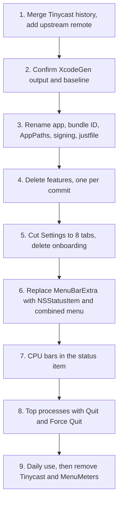

# Perch plan

Perch is a personal macOS menu bar app. It combines a small set of features from two apps:

- [Tinycast](https://github.com/abue-ammar/tinycast) (AGPL-3.0, Swift): launcher, emoji, clipboard, calculator, window management.
- [MenuMeters](https://github.com/yujitach/MenuMeters) (GPL-2.0, Objective-C): per-core CPU meter and top processes.

Perch is for one user on their own Macs. We do not distribute it.

## Source strategy

- Perch is a hard fork of Tinycast. The fork keeps the Tinycast git history.
- The `upstream` remote points to `abue-ammar/tinycast`.
- Do not merge `upstream`. Cherry-pick fixes by hand.
- Do not copy MenuMeters code. Use it only as a reference. The CPU meter is new Swift code.

## Identity

| Item | Value |
|---|---|
| App name | Perch |
| Bundle ID | `com.gstark.perch` |
| Settings file | `~/.config/perch/settings.json` |
| Data folder | `~/Library/Application Support/com.gstark.perch/` |

- Perch must run next to Tinycast and MenuMeters during the build.
- Perch does not import data from Tinycast.

## Features to keep

| Feature | Tinycast folder | Notes |
|---|---|---|
| App launcher | `Features/Launcher` | Includes System Settings panes. |
| Emoji finder | `Features/Emoji` | |
| Clipboard manager | `Features/Clipboard` | Includes Paste Sequentially. Keep the `ClipboardTextHelper` target. |
| Calculator | `Features/Calculator` | Keep all of it: math, units, currency, dates, time zones, history. |
| Window management | `Features/WindowManagement` | Includes Rooms. |
| Hotkeys | `Features/HotKeys` | |
| Settings | `Features/Settings` | Cut down to 8 tabs. |

## Features to delete

- AI, AppleShortcuts, Backup, Calendar, Camera, CustomCommands, Dictation, Dictionary, Extensions, FileSearch, MCP, MenuSearch, Notes, Onboarding, QuickActions, Quicklinks, Snippets, Support, SystemActions, TextInjection, WindowSwitcher.
- Launcher fallbacks.
- The updater and the "Support" menu item.
- The `DictationHelper` target.
- Raycast import and the Raycast extension runtime.

If a deleted feature holds code that a kept feature needs, move that code into the kept feature or into `Platform/`.

## Settings window

Keep these tabs:

1. General
2. Applications
3. System Settings
4. Commands
5. Window Management
6. Clipboard
7. Emoji & Symbols
8. Permissions

Delete all other tabs. Keep the JSON settings file and its file monitor.

If the Navigation tab holds launcher behavior that the user needs, keep it.

## Menu bar

Perch has one `NSStatusItem`. The CPU bars are its icon. It replaces the SwiftUI `MenuBarExtra`.

A left click and a right click open the same menu:

```
Top processes (10 rows, each row shows name and CPU %)
Open Activity Monitor
──────────
Open Launcher
Clipboard History
Settings...
──────────
Quit Perch
```

Build the menu when it opens.

## CPU meter

### Display

- Draw one thermometer bar per core. Fill each bar from the bottom.
- Stack user time (red) and system time (yellow) in each bar.
- Put the bars in 2 rows. The column count is `ceil(cores / 2)`.
- Read the core count at runtime. Do not hardcode it.
- Order the cores as `host_processor_info` returns them.
- Update every 1 second.
- Put all values in constants. Do not add a settings panel.

### Sampling

- Read per-core load with `host_processor_info`.
- Read per-process CPU time with `proc_listpids` and `proc_pidinfo(PROC_PIDTASKINFO)`.
- Sample processes on every tick, also when the menu is closed.
- Calculate CPU % as the change in CPU time divided by the elapsed time.
- Do not run `/usr/bin/top`.

### Process actions

- A click on a process row quits the process.
- When the user holds Option, each row changes to "Force Quit <name>". Use `NSMenuItem.isAlternate`.
- Show helper processes by their own names. Do not group them under the parent app.
- Show processes that the user does not own, but disable them.

| Process type | Quit | Force Quit |
|---|---|---|
| App with `NSRunningApplication` | `terminate()` | `forceTerminate()` |
| Background process | `SIGTERM` | `SIGKILL` |

### Code layout

Put the code in `Features/CPUMeter/`:

- `Model/`: pure calculation of the diffs. The `swiftc` test harnesses must be able to compile it.
- `Service/`: the sampler.
- `UI/`: the status item view and the menu.

## Build and tools

- XcodeGen owns the project. `project.yml` lists source folders, so a deleted folder leaves the project after `xcodegen generate`. Commit `project.yml` and the generated `Perch.xcodeproj` together.
- Keep the `Tinycast/` source folder and the Tinycast type names. Then upstream cherry-picks apply to the same paths.
- Sign every build with `Developer ID Application: Gavin Stark (JBRC9C74U7)`. A stable signature keeps the Accessibility permission across rebuilds.
- Do not notarize.
- Keep the `swiftc` test harnesses in `Tests/` for the kept features. Delete the harnesses for deleted features.

### justfile recipes

| Recipe | Action |
|---|---|
| `default` | List the recipes. |
| `generate` | Run `xcodegen generate`. |
| `build` | Build the Release configuration with `xcodebuild` into `build/`. |
| `test` | Run `Scripts/run-tests.sh`. |
| `lint` | Run `Scripts/lint.sh`. |
| `format` | Run `Scripts/format.sh`. |
| `install` | Build, quit the running Perch, copy it to `/Applications`, and open it. |
| `upstream` | Fetch `upstream` and show new commits that touch the kept feature folders. |

## Build order

Each step must end with a clean build, a passing `just test`, and one commit.



### Step notes

1. Start from the current Tinycast `main`. Record the commit hash in the merge commit message.
2. `xcodegen generate` must reproduce the committed project. The baseline build, the 93 harnesses, and lint must pass.
3. Replace every `com.tinycast.app` fallback in `Platform/AppPaths.swift`. Replace the `tinycast` config folder name. Register only the `perch://` URL scheme, so Perch never takes `tinycast://` or `raycast://` links from the installed apps.
4. Delete leaf features first: AI, Dictation, Notes, Extensions, MCP. Delete features that `AppCore.swift` uses heavily last.
5. Check the Navigation tab before you delete it.
6. Remove "Check for Updates" and "Support" from the menu.
9. Remove Tinycast and MenuMeters from the login items. Then delete them.

## Later

- Rename the project directory from `needs-name` to `perch`.
- Add a `release` recipe for the `gstark/tap` Homebrew cask, but only if Perch must run on a second Mac.
