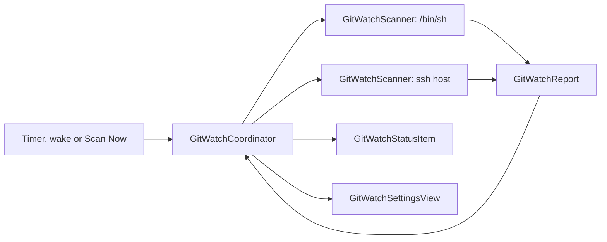

# Git Watch design

## Goal

Git Watch warns about local git work that could be lost. It scans this Mac and remote machines for
git repositories. A menu bar icon appears when a default branch has commits that are not on its
remote.

## Definitions

- **Default branch:** the branch that `origin/HEAD` names. If that ref does not exist, Git Watch
  uses `main`, then `master`, then the checked-out branch.
- **At risk:** a repository is at risk when its default branch is in state `ahead`, `noRemote` or
  `unpushed` (see [States](#states)).
- **Machine:** this Mac, or a remote host that Perch reaches over SSH.
- **Root:** a folder on a machine that Git Watch searches for repositories.

## Decisions

| Question | Decision |
| --- | --- |
| What is at risk | The default branch only. Other branches and uncommitted changes are out of scope. |
| How repos are found | You list root folders for each machine. There is no whole-disk scan. |
| How remotes are reached | `/usr/bin/ssh -o BatchMode=yes <host> sh -s`, with a script sent on stdin. |
| Freshness | Git Watch never runs `git fetch`. It compares with the remote-tracking ref. |
| Icon | A second `NSStatusItem`. It is visible only when one or more repos are at risk. |

Without a fetch, there is one known gap. If you push the same commits from a different clone, this
clone shows as `ahead` until you fetch it. This gap is acceptable.

## One code path for all machines

This Mac and a remote host run the same POSIX script. Only the command that starts the shell is
different:

- This Mac: `/bin/sh -s`
- A remote host: `/usr/bin/ssh -o BatchMode=yes -o ConnectTimeout=10 <host> sh -s`

A remote host must have `sh`, `find` and `git`. You do not install anything on it. SSH uses your
`~/.ssh/config`, your keys and your agent. The host field accepts an alias from `~/.ssh/config`.

## Parts

All parts are in `Tinycast/Features/GitWatch/`.

| Part | Folder | Job |
| --- | --- | --- |
| `GitWatchMachine` | `Model/` | A machine: its SSH host (empty for this Mac), roots and ignored repos. |
| `GitWatchScript` | `Model/` | Builds the shell script from the roots and the skip list. |
| `GitWatchRepo` | `Model/` | One repo line: path, branch, state and commit count. |
| `GitWatchReport` | `Model/` | Parses the script output into `GitWatchRepo` values and parse errors. |
| `GitWatchFailure` | `Model/` | Why a scan failed: launch, timeout, or a non-zero exit. |
| `GitWatchScanner` | `Service/` | Runs the script for one machine off the main actor, with a timeout. |
| `GitWatchCoordinator` | `UI/` | Owns the latest results, the schedule and the ignore list. |
| `GitWatchStatusItem` | `UI/` | The second `NSStatusItem` and its menu. |
| `GitWatchSettingsView` | `Settings/` | The Git Watch settings tab. |

`AppCore` owns `GitWatchCoordinator` and wires it in `start()`. The files in `Model/` do not import
AppKit or SwiftUI.



## The script

For each root, the script does these steps:

1. It runs `find <root>` and prunes each `.git` folder that it finds, so it does not search inside a
   repository's git data.
2. It skips these folder names: `node_modules`, `.build`, `vendor`, `Library`, `DerivedData`,
   `Pods`, `.cache`.
3. In each repository, it finds the default branch.
4. It finds the state of the default branch.
5. It prints one line for each repository.

A root that does not exist prints a `missingRoot` line and does not stop the scan.

### Output format

Each line has tab-separated fields:

```text
repo<TAB><path><TAB><branch><TAB><state><TAB><ahead count>
missingRoot<TAB><root>
```

A path can contain spaces. A path that contains a tab or a newline is not supported.
`GitWatchReport` reports such a line as a parse error.

### States

| State | Condition | At risk |
| --- | --- | --- |
| `ahead` | The branch has an upstream, and `git rev-list --count @{u}..<branch>` is more than 0. | Yes |
| `noRemote` | `git remote` prints nothing. | Yes |
| `unpushed` | A remote exists, but the branch has no upstream and no `<remote>/<branch>` ref. | Yes |
| `clean` | The branch has nothing to push. | No |
| `error` | A git command failed, or no default branch was found. | No |

If the branch has no upstream but `<remote>/<branch>` exists, the script compares with that ref.

## Schedule

- The coordinator scans all machines at launch, every 10 minutes, and when the Mac wakes.
- Machines scan at the same time in a task group.
- A scan has a 60-second timeout. The scanner ends the process when the timeout expires.
- A new scan does not start while the last scan is still running.
- Results stay in memory only. Nothing is saved between launches.

## Menu bar icon

- The icon is the SF Symbol `arrow.up.circle` with the count of at-risk repos next to it.
- The icon is hidden when no repo is at risk. Ignored repos do not count.
- The menu groups repos by machine. A row shows the repo folder name, the branch and the state, for
  example `perch  main ↑3` or `scratch  no remote`.
- If you click a local row, Finder opens the folder.
- If you click a remote row, Perch copies `ssh <host> -t 'cd <path>; exec $SHELL'` to the
  clipboard and shows a HUD.
- Holding Option turns each row into **Ignore <name>**, the same way the CPU menu shows
  Force Quit. A row with a submenu cannot also take a click, so a submenu does not work here.
- The menu ends with **Scan Now** and **Git Watch Settings…**.
- The setting "Show in menu bar" does not hide this icon. The icon shows only when there is a
  warning.

## Settings

- A new `SettingsTab.gitWatch` tab, titled "Git Watch", goes in the Features section.
- The tab shows one list of machines. "This Mac" is always first. You cannot remove it, but you can
  clear its roots.
- The SSH host is the identity of a machine. To change a host, remove the machine and add it again.
- Each machine has an SSH host, a list of roots, its last scan time and its last error.
- A host that starts with `-` or contains a space is refused, so it cannot become an ssh option.
- The tab has a **Scan Now** button. It reports the result through `HUDPresenter`.
- The tab lists ignored repos. You can remove a repo from the ignore list.
- One `SettingsFileKey`, `gitWatch.machines`, carries every machine with its roots and its ignore
  list. It grants no capability.
- The default for "This Mac" has the root `~/dev`. A new remote machine also starts with `~/dev`.

## Errors

- If SSH fails, for example because the host is unreachable or SSH asks for a password or a host
  key, the machine keeps its last results. The menu marks them `(stale)`.
- The error text from SSH shows in the Settings tab only.
- A background scan never shows a dialog or a HUD.
- A parse error does not stop the scan. The Settings tab shows the count of lines it could not
  parse.

## Tests

`Tests/git-watch-test.swift` compiles the files in `Model/`. `Scripts/run-tests.sh` runs it.

1. The parser handles each state, a path with spaces, a `missingRoot` line and a line it cannot
   parse.
2. The script runs through `/bin/sh` against temporary repos that the test creates:
   - a repo whose default branch is ahead of its upstream
   - a repo with no remote
   - a repo with a remote whose branch was never pushed
   - a clean repo
   - a repo inside `node_modules`, which the scan must skip
   - a repo whose `origin/HEAD` names a branch other than `main`
   - a root that does not exist

The second test uses a bare repo in a temporary folder as the remote. It needs no network and no
SSH.

## Doc changes

- Add `docs/features/git-watch.md`, which opens with its invariants.
- In `docs/features/cpu-meter.md`, change "One status item" to "one status item for the CPU meter".
- Add Git Watch to the feature list in `AGENTS.md` and `README.md`.
- Add the new folder to `docs/architecture.md` if that doc lists features.

## Out of scope

- Branches other than the default branch.
- Uncommitted or untracked changes.
- Stashes.
- Running `git fetch` or `git push` from Perch.
- Windows hosts.
